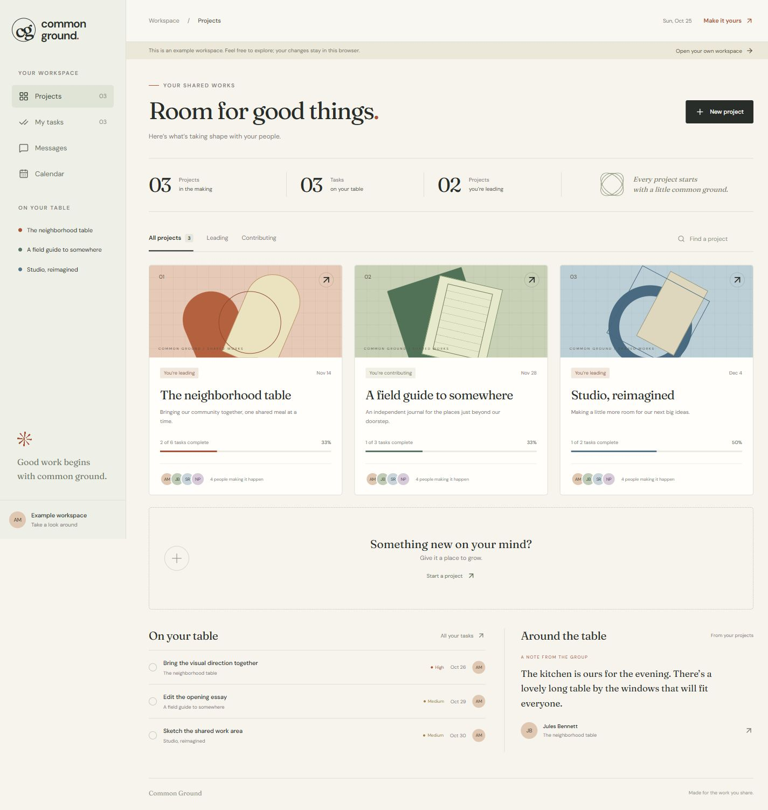
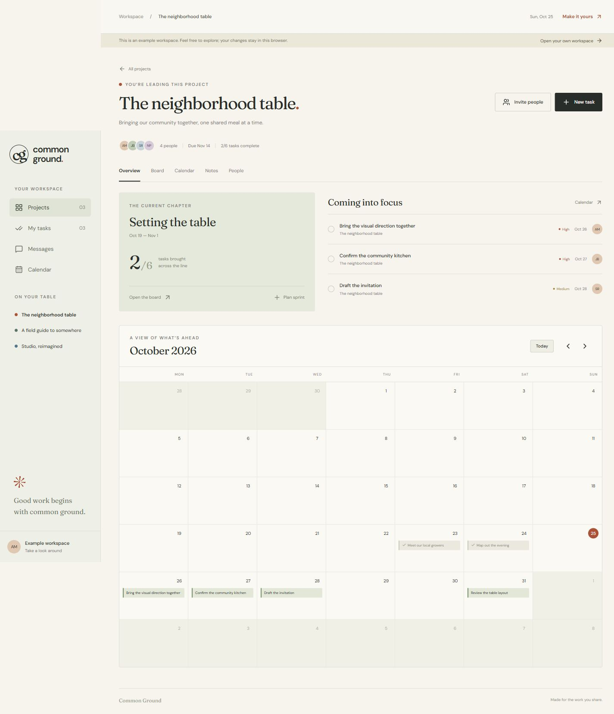
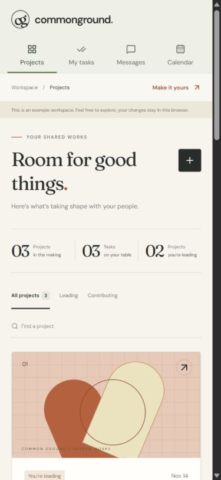

# Common Ground review

Reviewed October 25, 2026.

The application uses Fraunces for its expressive headings and DM Sans for working text, with a warm paper palette and custom geometric project illustrations. The dashboard is organized around ongoing group work, and the project pages keep planning, deadlines, notes, and people close together.

## Verified behavior

| Check | Result |
| --- | --- |
| Production build | Passed, including static generation and server route collection |
| TypeScript | Passed through the production build |
| Neon authentication | Three generated verification accounts successfully registered and authenticated |
| Multiple project roles | The same account led one project and joined another as a member |
| Invitations | Correct recipient accepted; a different account was rejected |
| Task planning | Lead created a sprint, assigned a task, and persisted its due date |
| Task authorization | Members could update their own assigned task status; unrelated users were rejected |
| Date validation | An impossible calendar date was rejected |
| Shared notes | Members published a shoutout visible to the project lead; outsiders were rejected |
| Private messages | Participants could exchange/read messages; outsiders could neither send nor retrieve them |
| Read state | Reading a conversation persisted the read timestamp |
| Browser interaction | Created an example task with an assignee, deadline, and sprint; verified calendar navigation and project/message views |
| Responsive layout | Reviewed at 1440×1000, 390×844, and 304×700; fixed narrow navigation and search overflow |
| Browser console | No console entries during the final browser review |
| Database | All eight application tables exist with row-level security enabled |
| Secrets | Local environment files are ignored; only `.env.example` is tracked |

The integration tests created private verification records under generated accounts and did not contact real people. The visible example workspace is separate, browser-local data. New real users receive their own empty workspace.

Database owner access remains server-only. As described in the README, the database owner bypasses RLS, so server session and membership checks enforce access for the application.

## Deployment state

The private GitHub repository and Vercel project are connected, and production is live at https://common-ground-mu.vercel.app. Production database and authentication environment variables are configured, with sensitive storage for the database credential and an independently generated cookie signing secret. The production origins are registered in Neon Auth’s trusted domains.

Vercel deployed application commit `b51b444e04bcaafb93abc771226198065a2c7431` with status `READY`. The complete integration suite was then run against the live URL and passed, including registration, authenticated sessions, multiple project roles, recipient-bound invitations, task permissions, shared notes, private messaging, and read state. The hosted sign-in page and Neon-backed session endpoint also returned successful responses. Vercel’s existing deployment protection settings were preserved.

Invitation links are shared manually and expire after seven days; the app does not send invitation emails. Workspace updates are fetched every fifteen seconds.

## Screenshots

### Project dashboard

### Project homepage and calendar

### Mobile dashboard

